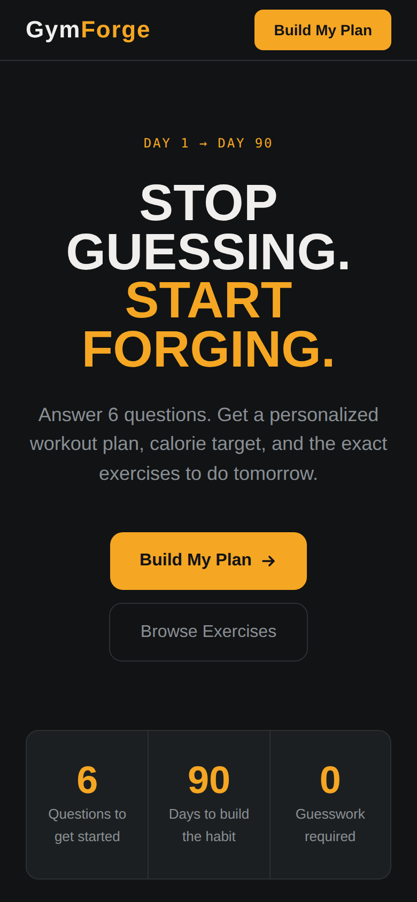
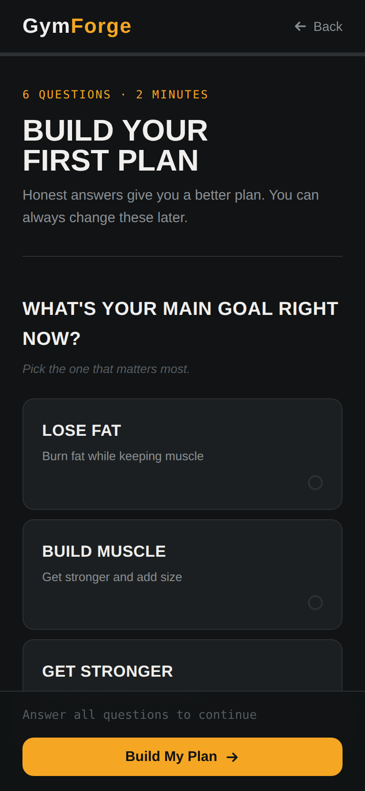
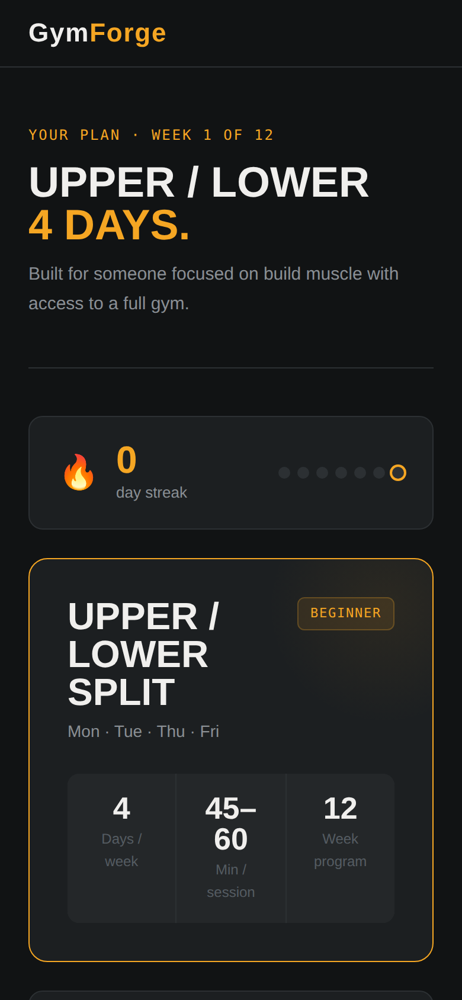
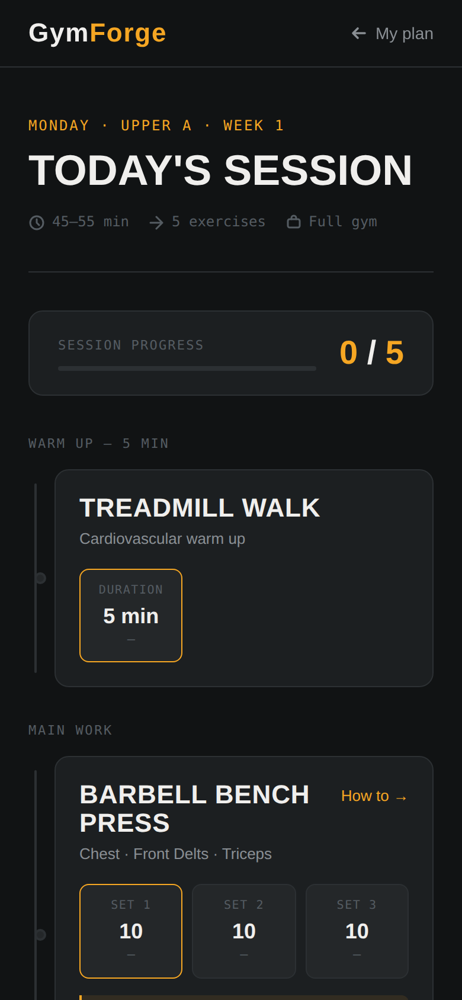
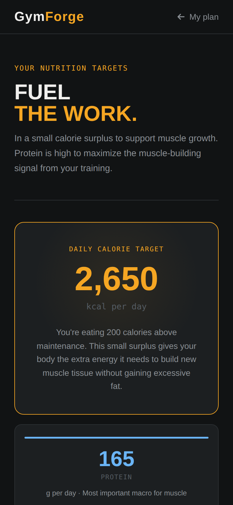

# GymForge

A personalized fitness platform for gym beginners — takes someone from zero to a working, personalized workout plan in under two minutes.

**Live:** https://devagarwal2709.github.io/gymforge/

<p align="center">
  
  
  
  
  
</p>

---

## Problem

Gym beginners don't lack exercise information — they lack a clear answer to "what do I do today?" GymForge solves that with a short onboarding flow that generates a personalized split, nutrition target, and daily workout session, all tracked without a backend.

---

## Features

- **6-question onboarding** — goal, experience, days/week, equipment, bodyweight, injuries
- **Auto-generated workout split** — Full Body / Upper-Lower / Push-Pull-Legs based on days available
- **Daily session builder** — cycles through A/B (or A/B/C) sessions based on sessions completed that week
- **Interactive workout logging** — tap a set, log weight, rest timer with Web Audio API beep, progress fills as you go
- **Nutrition calculator** — TDEE via the Mifflin-St Jeor formula, with a full BMR → TDEE → goal-adjusted breakdown and a high-protein food guide (Indian foods included)
- **Streak tracking** — 7-day streak counter, all stored in localStorage
- **Exercise detail pages** — muscles worked, step-by-step form, coaching cues, common mistakes, beginner alternatives

---

## Tech Stack

Plain HTML, CSS, and JavaScript — no frameworks, no build tools, no backend. Each of the 6 pages is self-contained (HTML + CSS + JS together) and runs directly in the browser or via VS Code Live Server.

| File | Purpose |
|---|---|
| `index.html` | Homepage |
| `onboarding.html` | 6-question intake form, saves profile + calculates nutrition |
| `plan.html` | Shows the generated split, weekly calendar, and streak |
| `workout.html` | Daily session — set logging, rest timer, progress tracking |
| `exercise.html` | Exercise detail page (currently hardcoded to Barbell Back Squat) |
| `nutrition.html` | Personalized calorie/macro breakdown |

---

## Design System

**Colors**
```

--bg #111314 --amber #F5A623 (primary accent)
--surface #1C1F21 --text #F0EFED
--surface-2 #242729 --text-2 #8A8F94
--border #2C3033 --text-3 #555C62
--danger #E05A5A --green #4CAF7D --blue #6AB4F5 --purple #B4A8F5

```

**Type**
- Barlow Condensed (700/800, uppercase) — headlines
- Inter (400/500/600) — body text
- JetBrains Mono — labels, numbers, stats

**Rules**
- Mobile-first, max content width 720px
- Cards: 12px radius, 1px border, no box-shadow
- Sticky nav with blur + 88% opacity on every page
- Active-voice microcopy — no "Submit", no "Welcome"

---

## Data Model

All data lives in `localStorage` — no backend, no accounts (yet).

```javascript
// gf_profile — set by onboarding.html
{
  goal: 'build_muscle',       // lose_fat / build_muscle / get_stronger
  experience: 'never',        // never / under_6mo / over_6mo
  days: '3',                  // 3 / 4 / 5
  equipment: 'full_gym',      // full_gym / home_gym / bodyweight
  unit: 'kg',                 // kg / lbs
  injuries: '',
  bodyweight: 75,
  bodyweightKg: 75,
  calories: 2600,
  protein: 165,
  carbs: 290,
  fat: 72,
  createdAt: '2024-01-15T...'
}

// gf_session_YYYY-MM-DD — set by workout.html, one per day
{
  squat: { sets: [{ done: true, weight: 60 }, ...] },
  bench: { sets: [...] },
  warmup: { sets: [...] }
}

// gf_favorites — set by exercise.html
['squat', 'bench', 'rdl']
```

## Split Logic

```
3 days/week → Full Body (A/B alternating)
4 days/week → Upper / Lower (A/B alternating)
5 days/week → Push / Pull / Legs (A/B alternating)

Today's session = sessionsCompletedThisWeek % sessions.length
```

---

## Running Locally

No install needed — open any `.html` file directly in a browser, or serve the folder with VS Code's Live Server extension for the best experience.

```bash
git clone https://github.com/devagarwal2709/gymforge.git
cd gymforge
# open index.html, or run Live Server
```

---

## Roadmap

- [x] Phase 1 — Static HTML/CSS pages
- [x] Phase 2 — JavaScript: onboarding, plan generation, workout logging, nutrition calc
- [x] Deployed to GitHub Pages
- [ ] Phase 3 — Rebuild in React: proper routing (`/exercise/squat`), reusable components (Nav, ExerciseCard, SetBox), per-exercise data
- [ ] Phase 4 — Backend (Node.js + Express + database): accounts, login, cross-device progress
- [ ] Phase 5 — AI coaching: "Ask the coach" button sending profile + question to an LLM API

---

## Why This Project

Built to design a full user journey end-to-end — onboarding → personalized plan → daily execution → nutrition — without relying on a framework or backend to do the heavy lifting. Each phase adds a new layer (React, then a backend, then AI) without rewriting what already works.